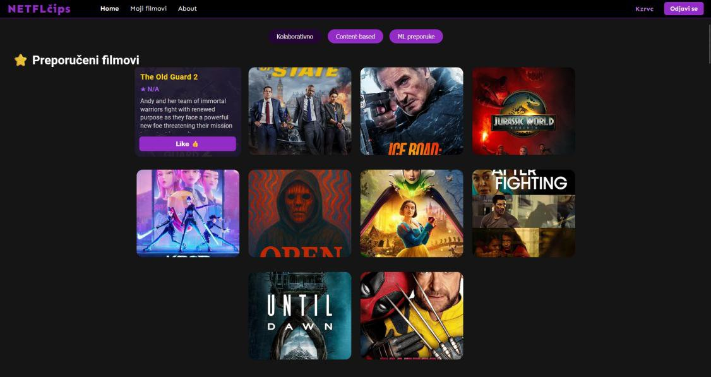
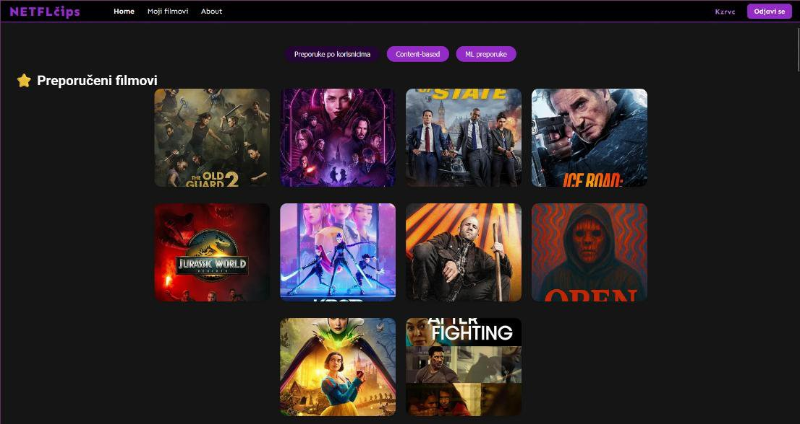
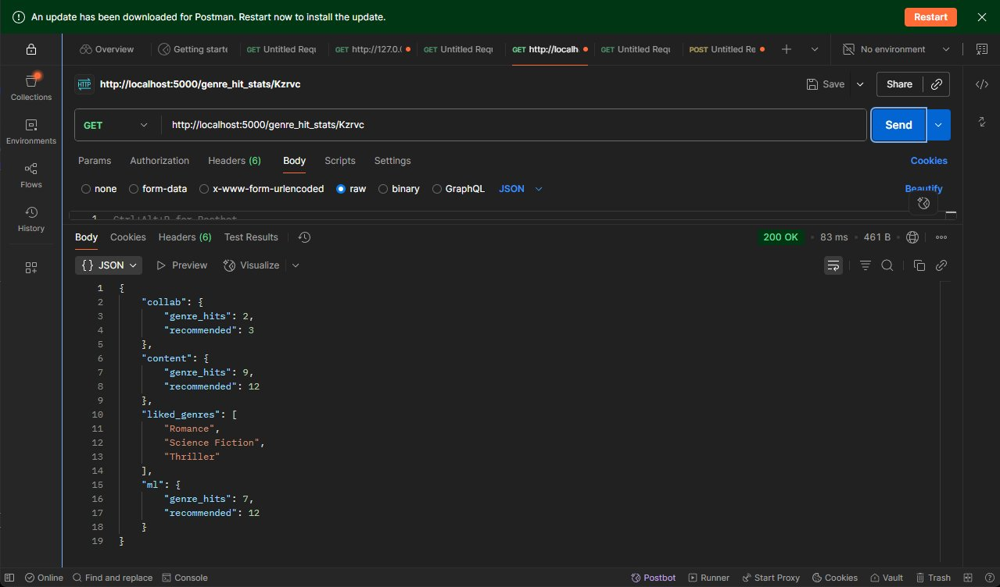

# NETFLčips – web sustav za preporuku filmova

Web aplikacija za preporuku filmova koja uspoređuje tri pristupa preporučivanju: **kolaborativno filtriranje**, **filtriranje prema sadržaju** i **strojno učenje (SVD)**. Korisnik se registrira, ocjenjuje filmove, a aplikacija mu na temelju ocjena predlaže nove filmove odabranom metodom.

Završni rad: *Programsko rješenje web sustava i usporedna analiza postupaka stvaranja preporuka filmova zasnovanih na filtriranju i strojnom učenju*
Sveučilišni prijediplomski studij Računarstvo, FERIT Osijek, 2025.
Autor: Anto Kožarević



## Funkcionalnosti

- registracija i prijava korisnika (lozinke se spremaju kao hash)
- pregled i pretraživanje filmova, ocjenjivanje (1–5), popis "Moji filmovi"
- tri načina preporuke, odabir jednim klikom na stranici
- statistika preporuka po žanrovima (`/genre_hit_stats/<korisnik>`) za usporedbu modela

## Metode preporuke

| Metoda | Ideja | Implementacija |
|--------|-------|----------------|
| Kolaborativno filtriranje | Preporuči filmove koje su visoko ocijenili korisnici sličnog ukusa | `get_recommendations_for_user` u `backend/app.py` |
| Filtriranje prema sadržaju | Preporuči filmove sličnih opisa onima koje je korisnik ocijenio | TF-IDF nad opisima filmova + kosinusna sličnost (scikit-learn) |
| Strojno učenje | Predvidi ocjene koje korisnik još nije dao | SVD matrična faktorizacija (scikit-surprise) |



Usporedba modela za istog korisnika (koliko preporučenih filmova pripada žanrovima koje korisnik voli):




- `backend/` – Flask API, SQLite baza (tablice `users`, `movies`, `ratings`, `preferences`), skripta za dohvat filmova s TMDb-a
- `frontend/` – statične stranice (`index.html`, `movies.html`, `about.html`) i `app.js` koji komunicira s API-jem na `http://127.0.0.1:5000`
- `docs/` – tekst završnog rada

## Pokretanje

1. Backend:

```bash
cd backend
pip install -r requirements.txt
export TMDB_API_KEY=<vaš ključ>     # Windows (PowerShell): $env:TMDB_API_KEY="<vaš ključ>"
python fetch_movies.py              # jednokratno: stvara bazu i dohvaća ~100 popularnih filmova
python app.py                       # API na http://127.0.0.1:5000
```

Besplatan TMDb API ključ: https://www.themoviedb.org/settings/api

2. Frontend (u novom terminalu):

```bash
cd frontend
python -m http.server 8000
```

Zatim otvorite http://localhost:8000, registrirajte se i ocijenite nekoliko filmova – preporuke se pojave nakon prvih ocjena.

> Napomena: `scikit-surprise` na novijim verzijama Pythona može zahtijevati C++ build alate. Bez njega rade kolaborativne i content-based preporuke, a ML preporuke vraćaju prazan popis.

## Ograničenja

Projekt je prototip za potrebe završnog rada: nema autentikacijskih tokena (API rute za dodavanje, uređivanje i brisanje filmova nisu zaštićene), a baza je mala (oko 100 filmova), pa su preporuke ograničene količinom ocjena.

## Dokumentacija

Cjelovit tekst rada: [`docs/Zavrsni_rad.pdf`](docs/Zavrsni_rad.pdf)
